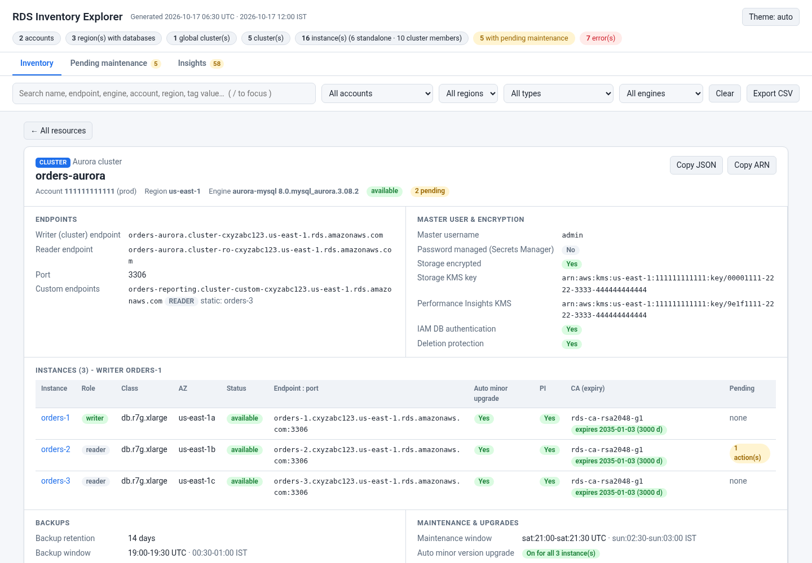
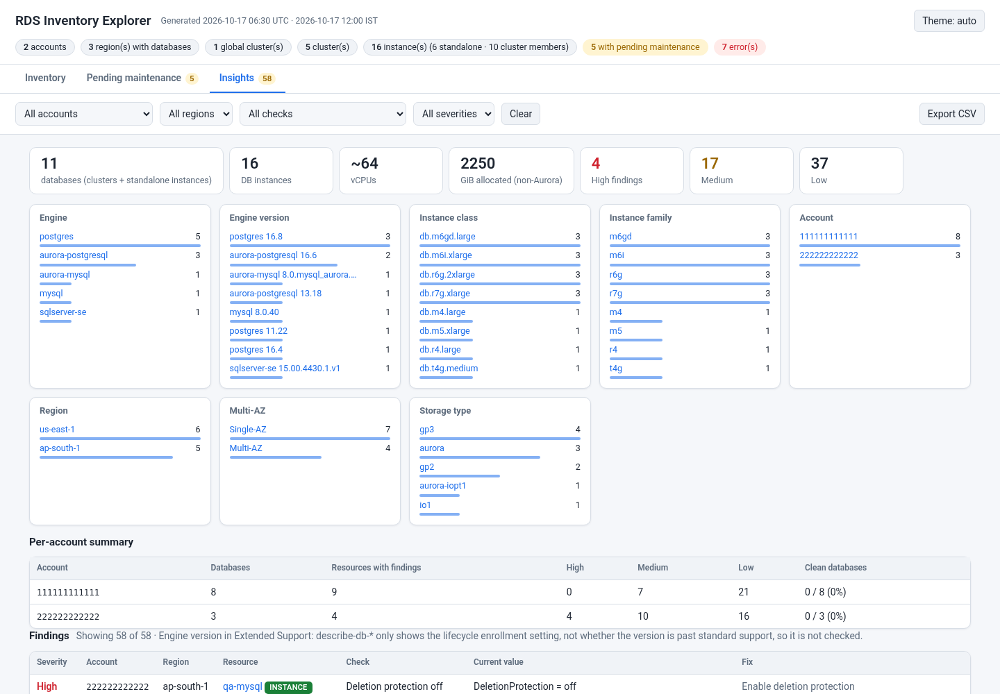
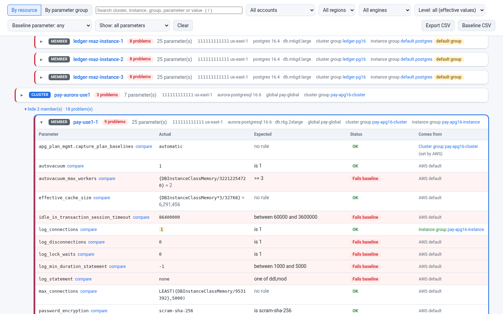
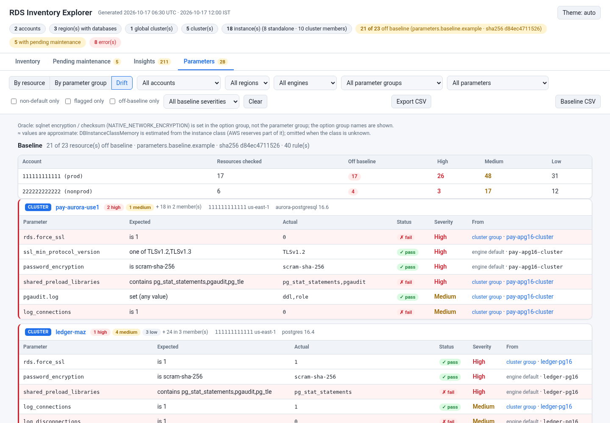

# rds-inventory-explorer

`rds_inventory_explorer.sh` is a **read-only** Bash / AWS CLI v2 script that writes **one self-contained HTML file** of your RDS and Aurora fleet across accounts (profiles) and regions. It covers Aurora global clusters, regional Aurora clusters and Multi-AZ DB clusters, and RDS instances (standalone, read replicas and cluster members). Open the file, type or pick a resource, and you see the full metadata for **that cluster or instance alone**.

- One file, no server, no internet needed. The data is embedded in the page and nothing is loaded from the network (CSP `default-src 'none'`).
- **No CloudWatch, no secret values.** Only `sts get-caller-identity`, `ec2 describe-regions` and `rds describe-*` calls are made. The script refuses anything else (`read_only_guard`). It shows the ARN of a managed master secret, never its value.
- A **Pending maintenance** tab lists every pending action across the fleet, sorted by urgency.
- An **Insights** tab summarises the fleet (engines, versions, classes, Multi-AZ, storage) and lists configuration findings (23 checks: public access, encryption, deletion protection, backups, monitoring and more). All tabs export to **CSV**.
- An opt-in **Parameters** tab (`--with-parameters`) shows the effective value of a curated list of parameters for every cluster and instance (instance group, then cluster group, then engine default), with search, a problems-only view, cluster / instance group levels, a fleet-wide view of any baseline parameter, and 6 more Insights checks.
- Errors in one account or region (AccessDenied, SCP, throttling, expired SSO) are recorded and shown in the page. They never stop the run.







A sample page built from the test mock is in [samples/sample.html](samples/sample.html). Download it and open it in a browser.

## Install (CloudShell)

```bash
curl -fsSLO https://github.com/manideepgrandhi/rds-inventory-explorer/releases/latest/download/rds-inventory-explorer.zip && curl -fsSLO https://github.com/manideepgrandhi/rds-inventory-explorer/releases/latest/download/rds-inventory-explorer.zip.sha256
sha256sum -c rds-inventory-explorer.zip.sha256 && unzip -oq rds-inventory-explorer.zip && cd rds-inventory-explorer
./rds_inventory_explorer.sh -A -F html,csv --save-data -o ./out
```

`sha256sum -c` must print `rds-inventory-explorer.zip: OK`. If it reports `FAILED`, the `&&` chain stops before `unzip`; delete the zip and do not run it. The script uses the CloudShell login (or `-P` profiles) and only reads.

## Quick start

```bash
# all enabled regions of two accounts; empty regions are skipped by a quick probe
./rds_inventory_explorer.sh -P prod,dev -A -o ~/rds_inventory

# one account, two regions
./rds_inventory_explorer.sh -P prod -r us-east-1,ap-south-1

# see the exact AWS calls first, without calling anything
./rds_inventory_explorer.sh -P prod,dev -A --dry-run
```

The output is `<prefix>_<accounts>_YYYYmmdd_HHMMSS.html` (default prefix `rds_inventory_explorer`; `<accounts>` is the 12-digit account ids joined with `_`, or `merged_N_accounts` for more than 3) with mode 0640. CSVs and the data file use the same stem: `…_inventory.csv`, `…_pending.csv`, `…_insights_findings.csv`, `…_data.json`. Requirements: Bash 4.4+, AWS CLI v2 and jq.

## How it works

1. **Arguments** are validated (regions, prefix, time zone, numbers). With `--dry-run` the call plan is printed and the script stops.
2. **Pre-check:** `aws` v2 and `jq` must be present.
3. **For each profile:**
   - `sts get-caller-identity` gives the account ID. If this call fails, the profile is recorded as an error and skipped. If no profile has valid credentials, the exit code is 2.
   - The region list comes from `-r`, the profile or environment default, or with `-A` from `ec2 describe-regions`.
   - **Discovery (`-A`):** each region is probed in parallel (`--probe-parallel`, default 8) with 2 one-page calls: `describe-db-instances` and `describe-db-clusters` with `--max-records 20 --query 'length(...)' --no-paginate`.
     - Only regions with at least one instance or cluster are read in full.
     - A probe that fails (AccessDenied, SCP, timeout) is shown as an error, and that region is **still read in full**. A failed probe is never treated as an empty region.
     - `--no-discover` skips the probe.
   - **Each region is read in full** with `describe-db-clusters`, `describe-db-instances`, `describe-global-clusters`, `describe-db-cluster-endpoints` (only when the region has clusters), `describe-pending-maintenance-actions` and `describe-certificates`. All of them use the CLI's automatic pagination.
4. **Model:** `lib/explorer.jq` joins everything into one list of resources.
   - Global clusters are de-duplicated across regions.
   - Members are linked to their clusters, replicas to their sources, and pending actions and CA expiry to each resource.
   - Times are converted to UTC and the `--tz` zone (default Asia/Kolkata, IST).
   - DocumentDB and Neptune are dropped unless `--include-docdb` is given.
5. **Insights:** `lib/insights.jq` adds the fleet facets and the findings to the model, so the page, `--csv` and `--merge` use one source.
6. **HTML:** the model is embedded as JSON into `lib/explorer_template.html`. `<`, U+2028 and U+2029 are escaped, so a tag value like `</script>` cannot break the page. The file is written atomically.

## Using the page

- **Search box:** type-ahead over names, endpoints, engine, version, account, region and tag values. `/` focuses it, the arrow keys and Enter pick a suggestion, and Esc closes the list.
- **Dropdowns:** account, region, type (global / cluster / instance / cluster member) and engine. They filter the list table. **Clear** resets everything.
- **Selecting a resource** shows only its card.
  - Names inside the card (writer, members, global cluster, replica source, replicas) are links to their own cards.
  - The selection is kept in the URL hash, so it survives a reload and can be bookmarked. ← All resources goes back to the list.
  - **Copy JSON** copies the raw AWS describe output for that resource. **Copy ARN** copies its ARN.
- **Tabs:** **Inventory**, **Pending maintenance** and **Insights**. The active tab is kept in the URL hash (`#tab=pending`, `#tab=insights`). Old `#id=…` links still open the Inventory card.
- **Pending maintenance tab:** one row per pending action, from the same `describe-pending-maintenance-actions` data (no extra AWS calls).
  - Count strip: total, past due, due within 7 days, due within 30 days (cumulative). Clicking a count filters by it.
  - Columns: account, region, resource (links to its card), type (cluster / instance / member), action, description, auto-applied after, forced apply, opt-in status, current apply, next maintenance window start (UTC + IST), and urgency.
  - Urgency comes from the earliest of the auto-applied, forced and current apply dates against the report time: **past due**, **< 7 days**, **< 30 days**, **later**, or **no date** (opt-in only). Rows are ordered most urgent first.
  - Filters for account, region, action and urgency, plus a text search. Every column header sorts (click again to reverse; empty values stay last).
  - Cards with pending actions show an **"N pending"** badge (a cluster counts its own and its members' actions). The list has a Pending column. Both jump to that resource's rows (`#tab=pending&res=…`); **Show all** drops the resource filter.
- **Export CSV:** a button on each tab downloads what is shown, after filters and sorting.
  - Pending: `<stem>_pending.csv`, 19 columns (dates in UTC and the second zone, days until earliest, urgency, resource ARN).
  - Insights: `<stem>_insights_findings.csv` (severity, account, region, resource, type, engine, check, current value, fix hint).
  - Inventory: `<stem>_inventory.csv`, one flat row per resource (account, profile, region, type, identifier, engine, version, class, status, endpoint, port, Multi-AZ, encryption, KMS key, backup retention, auto minor upgrade, maintenance window in both zones, pending counts, ARN), then one `tag:<key>` column per tag key.
  - The time stamp is the report's generation time. Files are UTF-8 with a BOM (Excel opens them correctly), RFC 4180 quoting and CRLF line ends. Cells starting with `=`, `+`, `-`, `@` or a tab get a leading `'` so spreadsheets do not run them as formulas (plain numbers such as `-3` are left alone).
- **Header:** counts only. These are accounts, regions with databases, global clusters, clusters, instances (standalone and members), resources with pending maintenance, and errors. Regions without databases are never listed.
- **Theme:** auto, light and dark. The choice is stored in `localStorage` under `mg-theme`, the same key the other reports in this repo use.
- **Errors panel** at the bottom: account, profile, region, the call that failed and the message.

## Insights tab

Built only from the data already collected (no extra AWS calls). The account and region dropdowns scope everything on the tab.

- **Totals:** databases (clusters + standalone instances), DB instances, approximate vCPUs, allocated GiB (non-Aurora), and High / Medium / Low findings.
- **Bars** for engine, engine version, instance class, instance family, account, region, Multi-AZ and storage type. Click a value to open Inventory filtered to those resources; a chip shows the filter and **×** removes it. Class and family count instances (cluster members included); the others count databases.
- **Per-account summary:** databases, resources with findings, High / Medium / Low, and clean databases (a cluster is clean only when it and every member have no finding).
- **Findings table:** severity, account, region, resource (links to its card), check, current value and fix hint. Filters for account, region, check and severity; **Export CSV** downloads the rows shown.
- Aurora is handled per level: encryption, deletion protection, backups, IAM auth, copy tags, log exports, port and master user are read from the cluster; public access, class, Enhanced Monitoring and CA from each member; auto minor upgrade and Performance Insights from the cluster when it carries the setting, otherwise from each member. A member's finding counts against its cluster in the per-account summary.

| Check id | Severity | Finding |
|---|---|---|
| `public_access` | High | Publicly accessible |
| `storage_not_encrypted` | High | Storage not encrypted |
| `deletion_protection_off` | High | Deletion protection off |
| `copy_tags_off` | Medium | Copy tags to snapshots off |
| `single_az` | Medium | Single-AZ |
| `backup_retention_low` | Medium | Backup retention < 7 days |
| `iam_auth_off` | Medium | IAM DB authentication off |
| `ca_expiring` | Medium | CA certificate expires < 90 days |
| `auto_minor_off` | Low | Auto minor version upgrade off |
| `pi_off` | Low | Performance Insights off |
| `em_off` | Low | Enhanced Monitoring off |
| `no_log_exports` | Low | No CloudWatch log exports |
| `default_port` | Low | Default port |
| `default_master_user` | Low | Default master username |
| `old_generation` | Low | Previous-generation class |
| `gp2_storage` | Low | gp2 storage |
| `stopped` | Low | Stopped |
| `default_param_group` | Medium | Default parameter group in use (`default.*` cluster or instance group; no extra calls) |
| `ssl_not_forced` | High | SSL / TLS not forced (`rds.force_ssl`, `require_secure_transport`) * |
| `tls_old_enabled` | High | TLS 1.0 / 1.1 enabled (SQL Server `rds.tls10` / `rds.tls11`) * |
| `conn_logging_off` | Medium | Connection logging off (`log_connections`) * |
| `md5_password` | Medium | md5 password encryption * |
| `param_pending_reboot` | Low | Parameter change pending reboot * |

\* needs `--with-parameters`; without it the tab marks these checks "not run". A member is flagged only for values that come from its own instance group; cluster-group values are flagged on the cluster.

`--skip-checks id,id` turns checks off (the tab lists what was skipped). Not checked: engine version in Extended Support, because `describe-db-*` only shows the enrollment setting, not whether the version is past standard support.

## Parameters tab (`--with-parameters`)

Opt-in (`--with-parameters`, or `with-parameters=true` in the config file). Only the names in `lib/parameters.list` are kept (one `[section]` per engine family: aurora-postgresql, postgres, aurora-mysql, mysql / mariadb, sqlserver, oracle); edit the list freely.

- **Calls (read-only, few):** per region, `describe-db-parameter-groups` and `describe-db-cluster-parameter-groups` once; per **in-use** group, `describe-db(-cluster)-parameters --source user` and `--source system` (never the full page-through); engine defaults once per family and group kind per account + region with `describe-engine-default(-cluster)-parameters --db-parameter-group-family`, cached. An error (AccessDenied ...) is recorded on that group and in the error list, never fatal; that group's resources show "not read" instead of guessed defaults. The step's elapsed time is printed in the log and in the page footer.
- **Effective value:** a group's value is user > system > engine default. For a cluster member: instance group, then cluster group, then engine default; the **From** column says which. Standalone instances use their instance group.
- **One filter row:** **Search** (type-ahead over cluster, instance, parameter group, parameter name and value; `/` focuses it, Esc clears it), **Account**, **Region**, **Engine**, **Level**, **Baseline parameter**, **Show**. Everything combines and is kept in the URL hash; **Clear** resets it.
- **Show:** *All parameters*; *Problems only* (fails the baseline or a security rule, each parameter counted once); *Changed from default*.
- **Level:** *All* (effective values); *Cluster group* (one row per cluster, the cluster group's values); *Instance group* (members under their cluster plus standalone instances, instance-group values only; a member whose instance group differs from its siblings is highlighted).
- **Colours:** red = fails the baseline or a security rule; yellow = pending reboot or couldn't check; grey = doesn't apply; no colour = OK. A legend above the list says the same.
- **By resource:** one row per cluster with its members nested (collapsible) and standalone instances, each with a status badge ("3 problems" or "OK"); problems first. A per-account baseline summary line sits on top. Click a row for **Parameter | Actual | Expected | Status | Comes from** (Instance group *name* / Cluster group *name* / AWS default). Each parameter has **Compare across clusters**: an inline panel with its value on every resource of the same engine family. Formula values (`{DBInstanceClassMemory*3/4}`) show an approximate value (≈). Oracle shows the option group note.
- **Baseline parameter:** pick one baseline parameter (grouped by engine) to get a fleet-wide table, one row per cluster / instance (members nested, level-aware): Account, Region, Resource, Engine / version, Actual, Expected, Status, Comes from. Failures first, counts on top ("16 resources: 1 OK, 15 fail").
- **By parameter group:** every in-use group with level, family, account, region, changed count, problem count, `default.*` groups flagged, and links to the clusters and instances using it. The card's parameter group rows link here, and the used-by links open the resource row (two-way).
- **Export CSV** downloads what is on screen (formula-guarded). With no filters the By-resource CSV is byte-identical to the script's `…_parameters.csv`; the script's CSVs are unchanged.
- **Merge:** `--save-data` carries the parameter data; `--merge` validates it (group kind, names, value types). Data files without it (v2.0.0, or a run without the flag) still merge, and the tab notes "Parameters not collected for account X".

## Parameter baseline (`--baseline FILE`)



With `--with-parameters`, every resource is checked against a **baseline**: your standard values. Without `--baseline` the bundled `lib/parameters.baseline.example` is used; `--baseline none` turns it off.

**Copy the file outside the release folder** before you edit it. A new release replaces the folder and your changes with it:

```bash
cp lib/parameters.baseline.example ~/parameters.baseline
./rds_inventory_explorer.sh -A --with-parameters --baseline ~/parameters.baseline     # or baseline=~/parameters.baseline in the conf file
```

- **Format:** one rule per line, `engine-family | parameter | rule | value | severity`, `#` comments. Families: `postgres` (RDS + Aurora), `mysql` (RDS MySQL / MariaDB + Aurora), `aurora-postgresql`, `aurora-mysql`, `sqlserver`, `oracle`. Rules: `=` `!=` `in` `contains` `!contains` `>` `>=` `<` `<=` `between` (`MIN-MAX`) `set` (any value). Severity `high`, `medium` or `low`. The file is parsed as text, never sourced; a bad line stops the run with its line number (exit 1).
- **Comparison:** booleans ignore case (`1/on/true/yes`, `0/off/false/no`); numbers compare as numbers; `{DBInstanceClassMemory…}` formulas use the approximate value (marked ≈); `contains` / `!contains` are case-insensitive list membership (`pg_stat_statements, PGAUDIT` contains `pgaudit`). PostgreSQL 18+ `log_connections` is a list: `= 1` passes for `on` / `all` or a list with `receipt`, `authentication` and `authorization`; PostgreSQL 17 and older treat it as a boolean.
- **Status:** pass, fail, missing (no value), n/a (the engine version has no such parameter; left out on Aurora cluster rows, where the members carry the instance-level parameters), unknown (group not readable, or the value is not comparable or was not collected). Values stay cluster-aware (instance group > cluster group > default).
- **Collection:** every parameter named in the baseline is fetched, even when `lib/parameters.list` omits it.
- **Page:** a header chip with the file name and short sha256 opens the Parameters tab with **Show: problems only**. A per-account summary line sits above the list, the Expected column and coloured Status come from the baseline, the **Baseline parameter** dropdown gives the fleet-wide view of one rule, and each resource card has a Baseline section. **Baseline CSV** downloads the baseline rows of what is shown; with no filters it is byte-identical to the script's `…_baseline.csv`.
- **Insights:** each failing rule is a finding, check id `baseline:<parameter>`. A member value inherited from the cluster group is reported once, on the cluster. Skip with `--skip-checks baseline` (all) or `baseline:<parameter>`.
- **Merge:** `--merge` re-checks the merged data against the baseline given at merge time (default: the bundled one), so one baseline applies to every account.

## What each card shows

| Card | Contents |
|---|---|
| **Global cluster** | Engine and version, status, global writer endpoint, primary and secondary regions, member clusters with role (primary / secondary), region, writer instance and write forwarding, storage encryption, deletion protection, failover state. |
| **Aurora / Multi-AZ cluster** | Writer and reader endpoints, port, custom endpoints (type, static and excluded members). Master username, whether the password is managed in Secrets Manager (secret ARN, status and its KMS key), storage KMS key, Performance Insights KMS key, IAM auth, deletion protection. **Instances:** role (writer / reader), class, AZ, status, endpoint:port, auto minor version upgrade, Performance Insights, CA and its expiry, and pending actions. **Backups:** retention, backup window (UTC + IST), earliest and latest restorable time, copy tags to snapshot, backtrack. **Maintenance:** maintenance window (UTC + IST), auto minor version upgrade (cluster setting, or how many members have it on), pending maintenance for the cluster and every member (action, description, opt-in, auto-applied-after and forced-apply dates with days left). Network and parameter groups, storage type, Serverless v2 capacity, engine lifecycle, global cluster link, and tags. |
| **Instance** (standalone or member) | Endpoint and port, class, AZ and secondary AZ, Multi-AZ, status. Storage type, allocated and max GB, IOPS and throughput. Master user, managed secret ARN and KMS key, storage KMS key, IAM auth, deletion protection, public access. Backups and maintenance windows (UTC + IST), auto minor version upgrade, pending actions, CA and its expiry. Read replica source and replicas (including cross-region), parent cluster and role, Performance Insights and its KMS key, Enhanced Monitoring, log exports, parameter and option groups, VPC, subnet group and security groups, and tags. |

## Options

| Option | Meaning |
|---|---|
| `-P, --profile NAME` | AWS CLI profile. Repeatable or comma-separated. The default is the default credential chain. |
| `-r, --region REGION` | Region(s). Repeatable or comma-separated. The default is the env / profile region. |
| `-A, --all-regions` | Every region enabled in each account, with discovery. |
| `--no-discover` | With `-A`: read every region in full, with no probe. |
| `--probe-parallel N` | Regions probed at once, 1–32 (default 8). |
| `--include-docdb` | Also list DocumentDB and Neptune clusters. |
| `-o, --output-dir DIR` | Output directory (default: the current directory). It is created if missing. |
| `--prefix NAME` | File name prefix. |
| `-F, --format LIST` | `html`, `csv` or `html,csv` (default `html`). CSV writes `…_inventory.csv`, `…_pending.csv`, `…_insights_findings.csv` (and `…_parameters.csv` + `…_baseline.csv` with `--with-parameters`), byte-identical to the page's Export CSV buttons with no filters. |
| `--csv` | Same as `-F html,csv`. |
| `--with-parameters` | Collect the Parameters tab (see above). Adds `…_parameters.csv` to `-F csv`. |
| `--baseline FILE` | Parameter baseline (default: the bundled `lib/parameters.baseline.example`; `none` to turn off). Adds `…_baseline.csv` to `-F csv`. |
| `--skip-checks LIST` | Insights check ids to skip (see the table above), plus `baseline` or `baseline:<parameter>`. |
| `-c, --config FILE` | key=value settings (long option names; never sourced). Command-line options override it. See `rds_inventory_explorer.conf.example`. |
| `--tz ZONE` | Second time zone shown next to UTC (default `Asia/Kolkata`). |
| `--aws-timeout SEC` / `--max-attempts N` | CLI connect/read timeout (default 30) and retry attempts (default 5). |
| `--keep-workdir` | Keep the raw AWS responses for debugging. |
| `--dry-run` | Print the calls that would run, and call nothing. |
| `--save-data` | Also write `<stem>_data.json`: the page's dataset plus the raw describe output, with the schema version, script version, generation time, accounts and the regions scanned. This is the input for `--merge`. |
| `--merge FILE\|DIR...` | Build one report from saved data files, with no AWS calls and no credentials (see below). Takes files, globs or folders. Works with `-o`, `--prefix`, `-F`, `--skip-checks`, `--save-data` and `--tz`. |
| `-v`, `-h`, `-V` | Verbose, help, version (2.1.0). |

**Exit codes:**

- `0`: the report was written. It may contain recorded errors.
- `1`: usage error.
- `2`: pre-check failed (aws or jq missing, or no profile has valid credentials).
- `3`: bad `--merge` input (file not found, not JSON, an HTML report, an old or unknown data schema, or an unexpected shape: an account that is not 12 digits, a bad region name, non-list data).
- `4`: output error.
- `130`: interrupted.

## Merging reports from several accounts on your desktop (Git Bash)

You do not need to copy files between accounts. Run the script in each account's CloudShell with `--save-data`, download the data files, and merge them on your own computer. The merge reads only the files, so it needs no AWS CLI, no credentials and no network.

1. In each account's CloudShell:

   ```bash
   ./rds_inventory_explorer.sh -A --save-data -o ~/rds_out
   ls ~/rds_out      # rds_inventory_explorer_<account>_<ts>_data.json is the file to download
   ```

2. Download it: **Actions → Download file**, then enter the full path, for example `/home/cloudshell-user/rds_out/rds_inventory_explorer_111111111111_20261017_120000_data.json`. Put the files from every account in one folder, for example `C:\Users\<you>\Downloads\rds`.
3. Install jq once: run `winget install jqlang.jq` in PowerShell, then reopen Git Bash and check with `jq --version` (1.6 or later).
4. In Git Bash, from the folder that holds the script and its `lib/` folder:

   ```bash
   ./rds_inventory_explorer.sh --merge ~/Downloads/rds/*_data.json -F html,csv -o ~/Downloads/rds/merged
   # a folder works too, as do Windows paths in quotes:
   ./rds_inventory_explorer.sh --merge "C:\Users\<you>\Downloads\rds" -F html,csv
   start ~/Downloads/rds/merged/rds_inventory_explorer_*.html
   ```

How the merge works:

- The page is rebuilt from the raw data in each file, so it has the same tabs (Insights included), filters, cards and Export CSV buttons as a normal report. `-F html,csv` writes the three CSVs, and `--save-data` writes the merged data file, which you can merge again later.
- **Urgency is relative to the merge time.** Days left, past due and the 7 / 30 day counts on the Pending tab are worked out at the time you merge, not at the time each file was collected. The header says "Merged" and lists every source file with its collection time.
- If two files hold the same account, the file collected later is used and the older one is ignored. The log says which file won, and the header marks the ignored one.
- The header shows counts only, never lists of region names.
- A file that is not a data file stops the merge with exit code 3 and says why. Examples are an HTML report instead of the `_data.json` file, a damaged download, or a file from an older script version.
- Requirements: Bash 4.4 or later (Git for Windows ships 5.x) and jq. The script copes with jq.exe's CRLF output, `C:\` and `/c/` paths, paths with spaces, and a `date` without `-d`.

## IAM permissions

Read-only. The AWS managed policy `ReadOnlyAccess` covers these, or use this minimal policy:

```json
{
  "Version": "2012-10-17",
  "Statement": [{
    "Effect": "Allow",
    "Action": [
      "sts:GetCallerIdentity",
      "ec2:DescribeRegions",
      "rds:DescribeGlobalClusters",
      "rds:DescribeDBClusters",
      "rds:DescribeDBInstances",
      "rds:DescribeDBClusterEndpoints",
      "rds:DescribePendingMaintenanceActions",
      "rds:DescribeCertificates",
      "rds:DescribeDBParameterGroups",
      "rds:DescribeDBClusterParameterGroups",
      "rds:DescribeDBParameters",
      "rds:DescribeDBClusterParameters",
      "rds:DescribeEngineDefaultParameters",
      "rds:DescribeEngineDefaultClusterParameters"
    ],
    "Resource": "*"
  }]
}
```

The last six are needed only with `--with-parameters` (CLI: `describe-db-parameter-groups`, `describe-db-cluster-parameter-groups`, `describe-db-parameters`, `describe-db-cluster-parameters`, `describe-engine-default-parameters`, `describe-engine-default-cluster-parameters`); without them the run still completes and records the errors. No CloudWatch, Secrets Manager or KMS permissions are needed. The script never calls those services.

## Tests

```bash
tests/run_tests.sh          # mock AWS CLI: options, model, HTML safety, call log, failure scenarios, browser check, scale
tests/validate_cli.sh       # the REAL AWS CLI v2 against a dead local port and a local paging fake endpoint
```

- **`run_tests.sh`** puts `tests/mock/aws` first on `PATH` and refuses to run if the `aws` it finds is not the mock. Credentials are fake, the endpoint is a dead local port, and all output goes to a temp dir.
  - It covers static checks (shellcheck, the jq library, the template), option validation, and a two-account fleet with a broken profile and an SCP-denied region.
  - It checks every card field listed above.
  - It checks the HTML: the `</script>` escape, no network references, the CSP, and empty regions never shown.
  - It checks the call log: only allowed operations, and probes are the only `--no-paginate` calls.
  - It runs the failure scenarios (throttled global clusters, empty fleet, no valid profile), the dry run (no calls), and a 1,950-resource scale run.
  - When `node` with `puppeteer-core` on `NODE_PATH` and Chrome are available, it also runs `tests/browser_check.js`. That drives the page in headless Chrome: search suggestions, filters, the card, links, the hash, Copy JSON, the theme, the Pending tab (hash, filters, search, sort, count strip, badge navigation, empty state), CSV export (the downloaded bytes are compared with the `--csv` files, plus one real Chrome download), layout at 680 / 900 / 1280 px and mobile dark, and no JS errors or network requests.
  - It checks `--save-data` and `--merge`: the data file round trip, a merge of three files where one account appears twice (the newer file wins and the log says so), and that the merged model and CSVs match a single scan. It also checks that urgency is recomputed at merge time, that bad, HTML, old-schema, newer-schema and partial files fail with exit code 3, and that the merge makes 0 AWS calls. The merge runs in a simulated Git Bash: no `aws` on PATH, a jq that writes CRLF, a `date` without `-d`, `C:\` and `/c/` paths, and spaces in paths. The browser check is run again on the merged page.
  - **Insights:** an audit fleet (`MOCK_AUDIT=1`) where every one of the 17 checks fires, `--skip-checks` (valid and unknown ids), `-F` (html,csv / csv / bad), the findings CSV, the config file (and that it is never executed), mode 0640, and rejected merge files (bad account, path-like region, non-list data, bad errors). `tests/insights_check.js` drives the tab: totals, bars, filters, CSV export equal to the script CSV, facet click to a filtered Inventory with its chip, mobile width, no JS errors, no network. A tampered merge with `` and `</script>` in a name is rendered to prove nothing executes.
  - **Parameters:** the audit fleet with `--with-parameters`: only `--source user` / `system` calls, engine defaults once per family, effective-value precedence (instance > cluster > default), system values, approximate formulas, unlisted names dropped, pending-reboot, an AccessDenied group, used-by, drift, the parameters CSV, the dry run, the config key, `--skip-checks`, merge with a file without parameters ("not collected"), group de-duplication and rejected tampered parameter data. **Baseline:** PG13 / PG16 / PG18 (`log_connections` list), `pg_tle` missing, n/a parameters, unreadable groups, bad baseline lines with their numbers, a never-executed baseline file, `--baseline none`, the conf key, `--skip-checks baseline` / `baseline:<p>`, the baseline CSV, and a merge with a different baseline (new sha256, new result); `tests/baseline_check.js` drives the page (chip, account summary, Baseline parameter table and counts, colours, cards, CSV equal to the script's, mobile). `tests/params_check.js` drives the tab: the filter row, search (`/`, Esc, combined filters), Show, Level, nesting and collapse, problems first, the detail columns, the compare panel, card ↔ group links both ways, CSV equal to the visible rows (and to the script CSV unfiltered), the hash, mobile, no JS errors, no network, and a tampered merge with `` in a parameter value.
  - It checks the `--csv` files: names, mode 640, BOM, CRLF, quoting, the formula guard, and that header and values match the model (Python's `csv` module as the parser).
- **`validate_cli.sh`** replays every command line the script issues through the real CLI, so syntax, `--query` and parameter validation are checked. It also runs negative controls, checks the mock output shapes against `--generate-cli-skeleton output`, and runs a full `-A` end to end through `tests/fake_aws_endpoint.py`. That run checks paging, that the probe skips the empty region, and that no CloudWatch, Secrets Manager or KMS request is made.

## Files

```
rds_inventory_explorer.sh        the script
lib/explorer.jq                  raw AWS JSON -> page model
lib/insights.jq                  fleet facets + findings (Insights tab, findings CSV)
lib/parameters.jq                parameter groups -> effective values, parameters CSV
lib/parameters.list              parameters kept per engine family (edit freely)
lib/parameters.baseline.example  default parameter baseline (copy it outside the release folder to edit)
lib/baseline_parse.jq            baseline file -> rules + errors with line numbers
lib/baseline.jq                  parameter rows x baseline rules -> status, summary, baseline CSV
lib/csv.jq                       page model -> CSV (used by -F csv)
lib/merge.jq                     saved data files -> one dataset (used by --merge)
lib/explorer_template.html       page (CSS + JS), data placeholder /*__EXPLORER_DATA__*/
rds_inventory_explorer.conf.example  settings file example
EXAMPLES.md                      command examples
samples/sample.html              page built from the test mock (fake accounts)
docs/screenshot.png              cluster card from the sample
docs/insights.png                Insights tab from the sample
docs/parameters.png              Parameters tab from the sample
docs/baseline.png                Baseline parameter view from the sample
tests/                           run_tests.sh, validate_cli.sh, browser_check.js, insights_check.js, params_check.js, baseline_check.js, fake_aws_endpoint.py, mock/aws
```

## Changelog

- **2.3.2**
  - Fix: the `shared_preload_libraries` security flag ("pgaudit not loaded") now uses the same case-insensitive, trimmed set membership as the baseline `contains` rule, so `pg_stat_statements, PGAUDIT ,pg_tle` is OK in both (it was red before). It also no longer matches a substring such as `pgaudit_ext`.
- **2.3.0**
  - **Simpler Parameters tab** (page only; data, merge and CSV formats unchanged). One filter row: Search, Account, Region, Engine, Level, Baseline parameter, Show. The flagged-only / non-default-only / off-baseline-only checkboxes, the group / parameter / severity dropdowns and the Drift view are gone.
  - **Search** over cluster, instance, parameter group, parameter name and value (`/` focuses, Esc clears). **Show:** all / problems only (baseline fail or security flag, counted once) / changed from default. **Level:** all / cluster group / instance group (differing member groups highlighted).
  - **By resource:** clusters with collapsible members, "N problems" / "OK" badges, problems first, per-account baseline summary; rows expand to Parameter | Actual | Expected | Status | Comes from; **Compare across clusters** panel replaces the Drift view.
  - **Baseline parameter** dropdown: fleet-wide table of one baseline rule with counts, failures first.
  - **By parameter group:** level, family, account, region, changed and problem counts, default-group flag, used-by links.
  - Plain wording and four colours with a legend; CSV export of what is on screen; state in the URL hash.
- **2.2.0**
  - **Parameter baseline** (`--baseline FILE`, `baseline=` in the conf; bundled default `lib/parameters.baseline.example`, `--baseline none` to turn off): pipe-separated rules (`= != in contains !contains > >= < <= between set`) with severity, checked at build time. A bad line stops the run with its line number.
  - Normalised comparison: booleans, numbers, approximate formulas, case-insensitive list membership, PostgreSQL 18+ `log_connections` lists. Status pass / fail / missing / n/a / unknown, cluster-aware.
  - Default baseline for PostgreSQL (`shared_preload_libraries` contains `pg_stat_statements,pgaudit,pg_tle`, SSL, scram, logging, autovacuum), MySQL (`tls_version` contains TLSv1.2 and excludes TLSv1,TLSv1.1, logging), SQL Server and Oracle. Baseline parameters are collected automatically.
  - Page: header chip (file + sha256), Baseline section in the Drift view (per-account summary, off-baseline resources first with severity badges and cluster member rollups, expected vs actual), off-baseline-only and severity filters, Baseline column in By resource, Baseline section on cards, Baseline CSV export.
  - Insights `baseline:<parameter>` findings (skippable); `…_baseline.csv` (formula-guarded); `--merge` re-checks with the baseline given at merge time.

- **2.1.0**
  - **Parameters tab** (opt-in `--with-parameters` / `with-parameters=true`): cluster-aware effective values (instance group > cluster group > engine default), members under their clusters, global cluster membership, pending-reboot status, approximate formula values, Oracle option group note. Views by resource, by parameter group (two-way links with the cards) and drift; filters; CSV export of the current view; `…_parameters.csv`.
  - Few calls: `--source user` and `--source system` per in-use group, engine defaults once per family per account + region (cached). Elapsed time in the log and footer. Errors per group, never fatal.
  - Insights: `default_param_group` (Medium, no extra calls) plus `ssl_not_forced`, `tls_old_enabled`, `conn_logging_off`, `md5_password`, `param_pending_reboot` (need `--with-parameters`). All skippable.
  - `--save-data` / `--merge` carry and validate the parameter data; older files still merge ("not collected for account X").
  - Narrow screens: the tab bar scrolls instead of overflowing.
- **2.0.0**
  - Moved to its own repository (`manideepgrandhi/rds-inventory-explorer`) with a release zip and `.sha256` checksum, built by a workflow pinned to a commit SHA.
  - **Insights tab:** fleet totals, CSS bars (no inline scripts or styles; CSP stays `default-src 'none'`), click-through to a filtered Inventory, per-account summary, findings table with filters and CSV export. 17 checks in `lib/insights.jq`, Aurora-aware.
  - `-F/--format html,csv`, `--skip-checks`, `-c/--config FILE` (never sourced).
  - File names carry the account ids: `<prefix>_<accounts>_<ts>.html`, `…_inventory.csv`, `…_pending.csv`, `…_insights_findings.csv`, `…_data.json`. `--merge DIR` reads both the new and the 1.2 data file names.
  - `--merge` rejects files with unexpected shapes (accounts that are not 12 digits, bad region names, non-list data).
  - The ARN row is gone from the instance card (Copy ARN stays).
- **1.2.0** - `--save-data` and offline `--merge` (Git Bash friendly), merged header.
- **1.1.0** - Pending maintenance tab, CSV export (page and `--csv`).
- **1.0.0** - Single-file offline HTML explorer for Aurora global clusters, Aurora / Multi-AZ clusters and RDS instances across profiles and regions.
